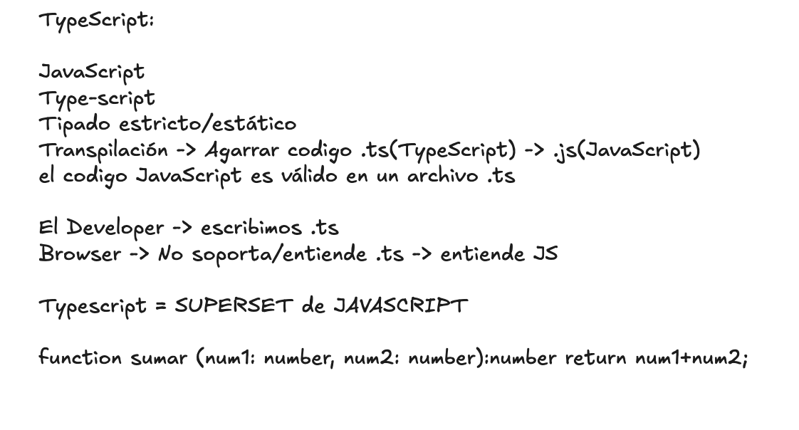

# Clase 1: Primera app con Vite + TypeScript

En esta clase vimos **qué es TypeScript y por qué existe** y armamos nuestro **primer proyecto frontend con Vite + TypeScript**: una página con un título, una descripción y un botón que responde a los clics.

## Qué hay en esta carpeta

| Carpeta / archivo | Qué es |
|---|---|
| [`starter/`](starter) | El proyecto recién creado con Vite, sin tocar. Es el punto de partida. |
| [`completo/`](completo) | Cómo queda el proyecto al terminar la clase. Usalo para comparar si algo no te anda. |
| [`apuntes/`](apuntes) | Los apuntes del pizarrón. |
| [`clase-01-typescript.pptx`](clase-01-typescript.pptx) | La presentación de la clase. |

## Cómo correr los proyectos

Necesitás tener instalado [Node.js](https://nodejs.org) (versión LTS). Para comprobarlo:

```bash
node -v
npm -v
```

Después, desde la carpeta del proyecto que quieras correr (`starter` o `completo`):

```bash
npm install     # instala las dependencias (solo la primera vez)
npm run dev     # levanta la app en http://localhost:5173
```

Para frenar el servidor: `Ctrl + C`.

## Lo que vimos en clase



### 1. ¿Qué es TypeScript?

**TypeScript es JavaScript con tipos.** Es un **superconjunto** (*superset*) de JavaScript: todo código JavaScript válido también es válido en un archivo `.ts`. No hay que aprender a programar de nuevo, solo se agregan los tipos.

Agrega **tipado estático**: los tipos se revisan **antes** de ejecutar el código, mientras escribís. JavaScript, en cambio, recién se da cuenta de los errores cuando el código ya está corriendo (o no se da cuenta nunca):

```js
// JavaScript
function calcularTotal(precio, cantidad) {
  return precio * cantidad;
}
calcularTotal("precio", 2); // NaN, y nadie avisa
```

```ts
// TypeScript
function calcularTotal(precio: number, cantidad: number): number {
  return precio * cantidad;
}
calcularTotal("precio", 2); // ❌ El editor lo marca antes de ejecutar
```

### 2. Transpilación

Nosotros escribimos `.ts`, pero **el navegador no entiende TypeScript: solo entiende JavaScript.** Por eso el código pasa por la **transpilación**:

```
   Developer                        Browser
 escribe .ts  ──── transpilación ───▶  ejecuta .js
```

Al transpilar, **los tipos desaparecen**. Lo que llega al navegador es JavaScript común:

```ts
// Lo que escribimos (.ts)
function sumar(num1: number, num2: number): number {
  return num1 + num2;
}
```

```js
// Lo que ejecuta el navegador (.js)
function sumar(num1, num2) {
  return num1 + num2;
}
```

### 3. Dos formas de tipar

```ts
let edad: number = 28;  // Anotación explícita: escribimos el tipo
let altura = 1.75;      // Inferencia: TypeScript deduce que es number
```

### 4. Compilación vs. ejecución

- **En tiempo de compilación** (antes de ejecutar), TypeScript avisa los errores de tipos.
- **En tiempo de ejecución** (con la app corriendo), pueden fallar otras cosas que TypeScript no controla: una API que responde algo raro, un elemento del HTML que no existe, un formulario mal completado.

> 💡 Pensalo como el **corrector ortográfico**: subraya mientras escribís, pero no te impide escribir, y lo subrayado no se imprime.

### 5. El proyecto con Vite

**Vite** es la herramienta que crea el proyecto, lo levanta en el navegador y lo actualiza solo cada vez que guardás (eso se llama **HMR**).

```bash
npm create vite@latest mi-proyecto -- --template vanilla-ts
```

Los archivos importantes:

| Archivo | Para qué sirve |
|---|---|
| `index.html` | El punto de entrada. Tiene el `<div id="app">` y carga `src/main.ts`. |
| `src/main.ts` | Acá va la lógica de la app. |
| `src/style.css` | Los estilos. Se importan desde `main.ts` con `import "./style.css"`. |
| `package.json` | Los datos del proyecto y los scripts (`dev`, `build`, `preview`). |
| `tsconfig.json` | La configuración de TypeScript. En [`completo/tsconfig.json`](completo/tsconfig.json) tiene cada opción comentada. |
| `node_modules/` | Las dependencias instaladas. No se toca y no se sube a GitHub. |

### 6. Que se vea bien no significa que no tenga errores

`npm run dev` **no revisa los tipos**: la app puede verse perfecta y tener errores igual. Para revisar los tipos de todo el proyecto:

```bash
npx tsc --noEmit
```

Si no muestra nada, está todo bien. (`--noEmit` significa: "revisá los tipos, pero no generes archivos `.js`").

Para armar la versión final del proyecto:

```bash
npm run build     # revisa los tipos y genera la carpeta dist/
npm run preview   # muestra esa versión final en el navegador
```

## Errores frecuentes

| Síntoma | Qué revisar |
|---|---|
| `npm run dev` dice que no encuentra `package.json` | Estás parado en otra carpeta. Entrá a la del proyecto con `cd`. |
| `vite: command not found` | Te falta correr `npm install`. |
| La página queda en blanco | Mirá la terminal y la consola del navegador (F12). Puede haber un error en `main.ts` o faltar el `#app` en el HTML. |
| Errores de `import` después de borrar archivos | Quedó un `import` a un archivo que ya no existe (por ejemplo, `counter.ts`). |
| El puerto 5173 está ocupado | Vite usa otro: abrí la dirección que aparece en la terminal. |

## Glosario rápido

- **Superconjunto (superset):** TypeScript incluye todo JavaScript y le agrega tipos.
- **Tipado estático:** los tipos se revisan antes de ejecutar.
- **Anotación de tipo:** escribir el tipo a mano: `let nombre: string`.
- **Inferencia:** TypeScript deduce el tipo solo: `let nombre = "Camila"`.
- **Transpilación:** traducir `.ts` a `.js` para que lo entienda el navegador.
- **Vite:** la herramienta que crea, levanta y arma el proyecto.
- **HMR:** el navegador se actualiza solo al guardar, sin recargar la página.
- **`tsc`:** el compilador de TypeScript, el que revisa los tipos.
- **`dist/`:** la carpeta con la versión final, lista para publicar.

## ✅ Checklist de la clase

- [ ] Proyecto creado con Vite + TypeScript
- [ ] HTML inicial con `#app`
- [ ] CSS vinculado desde `main.ts`
- [ ] `main.ts` funcionando
- [ ] Variables y una función tipadas
- [ ] Interacción con un botón
- [ ] `npx tsc --noEmit` sin errores
- [ ] `npm run build` genera `dist/`

## Para la próxima clase

- **Tarea:** personalizá el título, la descripción y los colores de tu proyecto según una temática que te guste (un catálogo, un sistema de reservas, un servicio...). Todavía no hace falta que la definas del todo.
- **Próximo tema:** `tsconfig.json` y el modo estricto, sobre este mismo proyecto.
