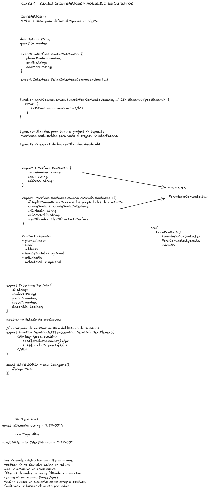

# Clase 2: Interfaces y modelado de datos

En esta clase seguimos con **el mismo proyecto** y le agregamos una **capa de modelos**. Aprendimos a describir entidades con `interface` y `type`, a relacionarlas por composición, a tipar colecciones y a separar los datos que llegan de afuera (DTO + mapper) de los que usa la aplicación. También vimos uniones de literales, uniones discriminadas y nombres que se entienden solos.

Este es el contenido de la **Semana 2** de Staff (Módulo 2 del material, páginas 64 a 121), incluida la consigna de la **Preentrega 2**.

## Qué hay en esta carpeta

| Carpeta / archivo | Qué es |
|---|---|
| [`starter/`](starter) | Punto de partida. En clase resolvimos varios modelos; quedan pendientes el mapper y tipar la colección. |
| [`completo/`](completo) | Cómo queda al terminar: modelos resueltos, catálogo en pantalla y README de las entidades. Ejemplo de la Preentrega 2. |
| [`apuntes/`](apuntes) | Los apuntes del pizarrón (Excalidraw). |
| [`clase-02-typescript.pptx`](clase-02-typescript.pptx) | La presentación de la clase. |

## Cómo correr los proyectos

Desde la carpeta del proyecto que quieras correr (`starter` o `completo`):

```bash
npm install          # instala las dependencias (solo la primera vez)
npm run dev          # levanta la app en http://localhost:5173
npx tsc --noEmit     # revisa los tipos de todo el proyecto
```

> En el `starter`, `npx tsc --noEmit` muestra **4 errores** (lo que quedó pendiente después de la clase). `npm run dev` anda igual, porque `main.ts` todavía no importa esos archivos.

## Lo que vimos en clase



### 1. Modelar datos: `interface` y `type`

**Modelar** es decidir qué información representa la aplicación y cómo se organiza. TypeScript nos da dos herramientas:

- `interface`: un contrato para la forma de un objeto.
- `type`: un nombre para un tipo. Sirve para objetos, pero también para uniones, literales y otras combinaciones.

```ts
export interface Categoria {
  readonly id: number;
  nombre: string;
  descripcion?: string; // opcional: puede no estar
}

export type EstadoActividad = "disponible" | "completa" | "cancelada";
```

`readonly` marca una propiedad que no se reasigna. El `?` marca una propiedad opcional.

**¿Cuál conviene?** No hay una sola respuesta. Como criterio inicial del material:

- `interface` para entidades u objetos que puedan extenderse.
- `type` para uniones, literales, funciones u otras combinaciones.
- Para un objeto simple, las dos sirven. Lo importante es ser consistentes.

Las interfaces se pueden **extender** (`extends`). Los types se pueden **combinar** con una intersección (`&`). TypeScript compara las formas (tipado estructural): si un objeto tiene las propiedades pedidas, es compatible, aunque no haya sido creado "como" esa interfaz.

> Definir una interfaz **no valida** los datos de una API. Solo describe la forma que esperamos. La validación en tiempo de ejecución se ve más adelante en el curso.

### 2. Composición, colecciones y DTO

**Composición** es armar una entidad con otras que ya definimos. Una reserva *tiene* una actividad y un profesional; no hereda de ellos:

```ts
export interface Reserva {
  readonly id: number;
  actividad: Actividad;
  profesional: Profesional;
  estado: EstadoReserva;
  notas?: string;
}
```

También se puede relacionar por identificador (`actividadId: number`) cuando no hace falta embeber todo el objeto.

Una **colección tipada** es un array de un modelo, por ejemplo `Actividad[]`. Sobre esa lista se puede filtrar, consultar o transformar con una función tipada. El resultado de `filter` sigue siendo `Actividad[]`.

Cuando los datos vienen de afuera, los nombres suelen ser distintos. Un **DTO** (*Data Transfer Object*) describe esa forma externa. Un **mapper** es la función que la transforma a nuestro **modelo de dominio**:

```ts
export interface ActividadDTO {
  activity_id: number;
  activity_name: string;
  price_amount: number;
  // ...
}

export function mapearActividad(datos: ActividadDTO, categoria: Categoria): Actividad {
  return {
    id: datos.activity_id,
    nombre: datos.activity_name,
    precio: datos.price_amount,
    // ...
    categoria,
  };
}
```

Así, si la API cambia un nombre, se actualiza el mapper y no toda la aplicación. No hace falta una API real: se puede trabajar con un objeto de ejemplo. Si las dos formas ya son iguales, no es obligatorio inventar un DTO.

Organizamos las definiciones en `src/models/` y las importamos con `import type` cuando solo necesitamos el tipo.

### 3. Uniones, literales y nombres

Un `string` acepta cualquier texto. Una **unión de literales** acepta solo los valores que listamos:

```ts
export type EstadoReserva = "pendiente" | "confirmada" | "cancelada";
```

Una **unión discriminada** describe objetos con formas distintas, usando una propiedad literal (el discriminante) para distinguirlos:

```ts
export type EstadoCarga =
  | { estado: "cargando" }
  | { estado: "exito"; datos: string[] }
  | { estado: "error"; mensaje: string };
```

Antes de acceder a `datos` o a `mensaje`, hay que comprobar `resultado.estado`. Si no, TypeScript marca error: esa propiedad no existe en todas las variantes.

Los nombres tienen que hablar del **dominio** (Actividad, Reserva, EstadoReserva), no de nombres vacíos como `Data` o `Info`. Las interfaces van en PascalCase, sin el prefijo `I`.

## 🛠️ Ejercicios

En clase resolvimos buena parte de los modelos. Quedan pendientes el **mapper** y tipar la **colección**. Corré:

```bash
npx tsc --noEmit
```

| # | Archivo | Tema | Estado |
|---|---|---|---|
| 1 | `models/profesional.ts` | Tipar un parámetro con una `interface` | Hecho en clase |
| 2 | `models/actividad.ts` | `type` + unión de literales | Hecho en clase |
| 3 | `models/actividad.ts` | Composición con `Categoria` | Hecho en clase |
| 4 | `models/reserva.ts` | `readonly` (no reasignar `id`) | Hecho en clase |
| 5 | `utils/mapearActividad.ts` | DTO + mapper | Pendiente (1 error) |
| 6 | `models/estado-carga.ts` | Unión discriminada (narrowing) | Hecho en clase |
| 7 | `models/actividad.ts` | `extends` en una interfaz | Hecho en clase |
| 8 | `models/colecciones.ts` | Array y función tipada | Pendiente (3 errores) |

Corregí lo pendiente de a uno hasta que `tsc` no muestre nada. Las soluciones están en `completo/`.

Cuando `tsc` quede limpio, importá los modelos en `src/main.ts` y mostrá el catálogo (actividades, un filtro, el DTO mapeado y las reservas). El `completo/` muestra una forma de hacerlo. Después, `npm run build` tiene que pasar.

## Errores frecuentes

| Tentación | Por qué no |
|---|---|
| Usar `any` en los modelos | Compila, pero TypeScript deja de comprobar |
| Declarar un estado como `string` | Admite valores que la aplicación no reconoce |
| Pensar que la interfaz valida lo que llega de una API | Solo describe la forma; no revisa los datos en tiempo de ejecución |
| Extender una interfaz para decir "tiene un" | Si una reserva *tiene* una actividad, es composición, no `extends` |
| Devolver el DTO como si fuera el modelo | Los nombres no coinciden: hay que mapear |
| Acceder a `mensaje` o `datos` sin mirar el discriminante | Esa propiedad no existe en todas las variantes de la unión |

## Glosario rápido

- **`interface`:** contrato de un objeto (qué propiedades tiene y de qué tipo).
- **`type`:** un nombre para un tipo. Útil para uniones y literales.
- **`readonly`:** la propiedad no se reasigna.
- **Propiedad opcional (`?`):** puede no estar.
- **Composición:** una entidad contiene otra (`actividad: Actividad`).
- **`extends`:** una interfaz reutiliza las propiedades de otra.
- **DTO:** la forma de los datos que se intercambian (por ejemplo, con una API).
- **Modelo de dominio:** la forma que usa internamente nuestra aplicación.
- **Mapper:** función que transforma un DTO en un modelo de dominio (o al revés).
- **Unión de literales:** `"pendiente" \| "confirmada" \| "cancelada"`.
- **Unión discriminada:** unión de objetos con una propiedad literal que los distingue.
- **`import type`:** importa solo el tipo, no un valor.

## ✅ Checklist de la clase

- [ ] Sé cuándo usar `interface` y cuándo usar `type`
- [ ] Usé `readonly` y propiedades opcionales
- [ ] Relacioné entidades por composición
- [ ] Tipé un array y una función que lo filtra o consulta
- [ ] Armé un DTO y un mapper
- [ ] Usé una unión de literales y una unión discriminada
- [ ] Organicé los modelos en `src/models/`
- [ ] `npx tsc --noEmit` no muestra errores y `npm run build` genera `dist/`

## Preentrega 2

La Preentrega 2 pide incorporar esta capa de modelos **a tu propio proyecto**, con tu temática (no hace falta copiar "Yoga" y "Pilates"). El `completo/` es un ejemplo que cubre lo que pide la consigna:

- al menos tres interfaces relacionadas, con `readonly` y opcionales
- un `type` con unión de literales
- al menos una composición
- un array tipado con tres o más elementos y una función tipada que lo use
- un DTO y su mapper
- archivos organizados y reutilizables
- README que explica las entidades y por qué se usó `interface` o `type`
- modo estricto, sin `any` en los modelos, y `npm run build` sin errores

La entrega oficial es el enlace a tu repositorio público de GitHub (el mismo de la Preentrega 1). No se pide PDF, Word ni ZIP. No hay que conectar una API ni Firebase.

## Para la próxima clase

- **Tarea:** terminá los 8 ejercicios, mostrá el catálogo en tu `main.ts` y dejá documentadas las entidades en el README del proyecto.
- **Preentrega 2:** aplicá lo mismo a *tu* temática y publicá los cambios en GitHub cuando el repo esté listo.
- **Próximo tema (oficial):** TypeScript aplicado al DOM, eventos y formularios (Módulo 3).
